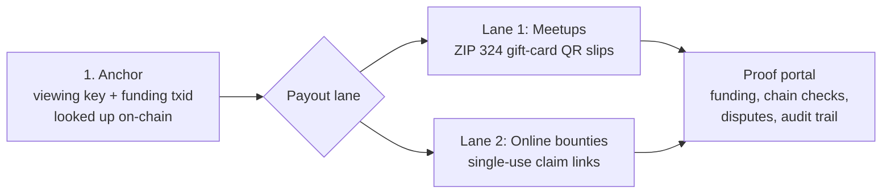

# ZecClaim

**Non-custodial shielded payouts for Zcash meetups and bounties, checked on-chain and published on a public proof portal.**


ZecClaim helps community organizers pay many people in shielded ZEC: meetup attendees through printable gift-card QR slips, and online bounty winners through single-use claim links. It never holds keys or funds. The organizer signs every payment in their own wallet, ZecClaim checks the results on-chain, and a public proof portal shows where every zatoshi of the prize pool sits.

Built for post-NU7 Zcash (November 2026): 25-second blocks, a 330-action block budget, the Ironwood pool and ZIP 2009 fees of 1,000 zatoshi per action.

---

## Contents

1. [Why ZecClaim](#why-zecclaim)
2. [At a Glance](#at-a-glance)
3. [How It Works](#how-it-works)
4. [Features](#features)
5. [Trust Model](#trust-model)
6. [Judge Quick Start](#judge-quick-start)
7. [Getting Started](#getting-started)
8. [Project Structure](#project-structure)
9. [Routes and API](#routes-and-api)
10. [Technical Documentation](#technical-documentation)
11. [Post-NU7 Protocol Constants](#post-nu7-protocol-constants)
12. [Quality and Verification](#quality-and-verification)
13. [Roadmap](#roadmap)
14. [For AI Agents and Contributors](#for-ai-agents-and-contributors)
15. [License](#license)

---

## Why ZecClaim

Paying 30 meetup attendees or 50 bounty winners in shielded ZEC raises four practical problems. ZecClaim answers each one without taking custody.

| Challenge | How ZecClaim answers it |
| :--- | :--- |
| Shielded pools have no escrow: no timelocks or contracts can hold a prize pool, and transparent multisig escrow publicly links every recipient. | Each campaign is anchored to a read-only viewing key and an on-chain funding transaction. The organizer's own wallet signs every payout. |
| Recipients paste the wrong address: one transparent address, or a Unified Address with a transparent receiver, puts a payout on the public chain. | Strict ZIP 316 preflight in the browser and again on the server refuses every transparent receiver with clear guidance. |
| The community has to trust the organizer's spreadsheet. | A public proof portal shows the funding, every payout transaction confirmed on-chain, disputes and a full audit trail, without revealing any recipient. |
| Storing names next to addresses creates a surveillance honeypot. | Single-use links stored only as peppered hashes, no social logins, and a one-click address scrub that publishes a SHA-256 commitment. |

## At a Glance

| | |
| :--- | :--- |
| **Custody** | Non-custodial. No spending key, seed phrase or signed transaction ever reaches the server. |
| **Payout lanes** | Lane 1: in-person meetups with ZIP 324 gift cards. Lane 2: online bounties with claim links and ZIP 321 batches. Hybrid campaigns use both. |
| **Networks** | Zcash testnet and mainnet. The network is read from the campaign's viewing key. |
| **Chain access** | Public lightwalletd nodes: `testnet.zec.rocks` and the Zcash India node `zebra.openlightnodes.org`. |
| **Standards** | ZIP 316, ZIP 321, ZIP 324, ZIP 317, ZIP 2009, ZIP 259 (NU7). |
| **Stack** | Next.js 15, React 19, TypeScript (strict), Tailwind CSS, MongoDB, Zod. |
| **License** | MIT |

---

## How It Works



**Anchor.** The organizer registers a read-only Unified Full Viewing Key and the funding transaction ID. ZecClaim looks the transaction up on-chain, records the chain height, and converts the chosen clawback date into a block height.

**Lane 1: meetups (gift cards).**

1. Optionally plan each card's amount, then mint the cards in Vizor or Zodl.
2. Import the gift-card CSV. It is parsed in the browser, and card secrets (`#key=`) never leave it.
3. Print the QR slips, or hand them out one at a time in desk mode.
4. Attendees sweep their card in Vizor 0.0.57+ or Zodl 3.16+ (about 50 seconds) and confirm with the memo code, optionally adding the sweep txid, which is checked on-chain.
5. After the expiry height, unclaimed value returns to the treasury, and the clawback transaction is checked on-chain.

**Lane 2: online bounties (claim links).**

1. Create one private link per winner: split evenly, a fixed amount, or a custom amount per link.
2. Winners open their link and submit a shielded address, checked live against ZIP 316 and the campaign's network.
3. Lock and export: payouts are chunked into batches of at most 300 actions, as ZIP 321 URIs and a ready-to-run `zingo-cli` script.
4. The organizer signs and broadcasts in their own wallet, then records the txid. ZecClaim checks it on-chain.
5. Scrub: stored addresses are deleted and a SHA-256 commitment of the deleted set is published.

**Proof portal.** Anyone can open `/proof/[campaignId]` to see where the funding sits, what the chain confirms, and every event in the campaign's history.

---

## Features

### For organizers

- **Guided campaign setup:** the network is detected from the viewing key, the funding txid is looked up as you type, the clawback date becomes a block height from the live chain tip, and a live budget summary and checklist show when the campaign is ready.
- **Flexible amounts:** claim links can split the pool evenly, pay a fixed amount, or pay a custom amount per link for tiered prizes. Gift-card amounts can be planned per card before minting, and imports are checked against the plan.
- **Fee-safe budgets:** ZIP 2009 batch fees and gift-card sweep buffers are reserved up front, so a campaign can never promise more than its funding.
- **Wallet-ready batches:** each export produces ZIP 321 payment URIs and a `zingo-cli` script with the correct `--chain` flag and confirmation waits between transactions.
- **Organizer console:** live status for every link, reissue of lost or leaked links, import of addresses collected elsewhere (for example a Luma export, with personal data dropped in the browser), payout recording, gift-card slips and clawback.
- **One-time secrets:** the organizer secret and claim links are shown once, with a backup download and CSV export.

### For recipients

- **No accounts:** a single-use link is all a winner needs. No sign-up and no social login.
- **Instant address feedback:** transparent or mixed addresses are refused with a clear, friendly explanation before anything is submitted.
- **Live payout tracking:** the claim link shows the payout's progress up to the on-chain transaction, with height and confirmations.
- **A public voice:** if a recorded payout never arrives, the recipient can publish a report on the proof portal, without revealing their address.
- **Fast meetup onboarding:** attendees scan a printed QR slip and receive shielded ZEC in about two blocks.

### For auditors and the community

- **Proof portal:** six funding buckets that always add up to the declared total, a "What the chain confirms" section, disputes and payout reports, a ledger without addresses, the scrub commitment, and the full audit trail.
- **Viewing-key audit guide:** step-by-step commands to verify the key's fingerprint and inspect every payout in a view-only wallet on the auditor's own computer. The key is never pasted into a website.
- **Clearly labeled demo data:** sandbox fixtures are always marked as such.

### Security and privacy

- **Strict ZIP 316 validation:** full Bech32m and F4Jumble decoding with the ZIP 316 consumer rules (ascending typecodes, no duplicates, MUST-understand metadata). Legacy Sapling addresses are fully decoded and accepted with a migration note.
- **Viewing key private by default:** public pages show only its SHA-256 fingerprint. Publishing the full key is an explicit opt-in.
- **Payout integrity:** a payout must be found on-chain, mined after the campaign was anchored, and recorded by only one campaign. Payouts with transparent outputs or too few shielded outputs are flagged publicly.
- **Real funding only:** a campaign is anchored only to a funding transaction found on-chain with shielded outputs, and each funding transaction anchors exactly one campaign.
- **Hardened by default:** organizer sign-in verified server-side, rate limits shared through MongoDB, a fail-closed database, a strict Content Security Policy, `no-referrer` so claim tokens never leak, `noindex` on private pages, and no public campaign listing.

### Experience

- Tactile neomorphic interface in light and dark themes (toggle in the header, or `?theme=dark`).
- Responsive layout for phones, so attendees and organizers can use it at the venue.

---

## Trust Model

ZecClaim states exactly what each fact rests on, so the proof portal never claims more than the evidence supports.

| Fact | Established by |
| :--- | :--- |
| Recipient addresses are shielded | ZIP 316 decoding, in the browser and on the server |
| Funding, payout, sweep and clawback transactions exist, with height and confirmations | lightwalletd `GetTransaction` and `GetLatestBlock` |
| A payout is fully shielded and has room for every recipient | Compact transaction shape from lightwalletd `GetBlock` |
| A payout was mined after the campaign was anchored and belongs to one campaign | Anchor height and a cross-campaign transaction check |
| The clawback happened after the expiry height | The live chain tip |
| Who sent a payout, and the amounts and recipients inside it | An auditor holding the campaign viewing key, in their own view-only wallet (guide on the proof portal). Recipients can publicly report a payout that did not arrive. Automatic checking is on the [roadmap](#roadmap). |
| A gift card reached its attendee | The attendee's memo code, plus an optional sweep txid checked on-chain |

The full threat model, with mitigations for each threat, is in [`docs/SECURITY_AND_TRUST.md`](docs/SECURITY_AND_TRUST.md).

---

## Judge Quick Start

### Two-minute sandbox (no wallet needed)

Open `/sandbox` (linked from the home page). It is one seeded testnet campaign with labeled fixture data. Its organizer secret is public and unlocks only that campaign: `sec_demo_nu7_mumbai_organizer_secret_key`.

1. **Claim with a shielded address:** open the sandbox claim link. Try the transparent or mixed example from "Will my address be accepted?" and watch it get refused, then submit a shielded one. Reopen the link to see the payout progress.
2. **Confirm a meetup card:** on the receipt page, use "Fill CARD-03 receipt" (memo code `ACK-4T8B2N7Y`). Optionally paste any recent testnet txid as the sweep txid: it is looked up live. Then use "Fill CARD-05 dispute" and flag it.
3. **Export, pay and scrub:** open the organizer console (the sandbox secret is prefilled). In the "Payout" tab, lock and export, copy the ZIP 321 URI or download the `zingo-cli` script, record a testnet payout txid (checked live), then scrub.
4. **Audit:** the proof portal shows the funding buckets, what the chain confirms, the dispute, the ledger, the scrub commitment and the event trail.

"Reset sandbox" restores the fixtures at any time.

### Real testnet run

1. In Zingo (or `zingo-cli --chain testnet`), fund a testnet account used only for this campaign and run `export_ufvk`.
2. Send the prize pool to it in one shielded transaction and copy the txid.
3. Open `/admin/new`: paste the viewing key and the txid, enter the amount and the number of winners (or one amount per winner with "Custom per link"), and pick when the clawback opens. Create the campaign, download the backup, and send each winner a link.
4. Winners open their link and submit a `utest1...` address. The console's link table updates live.
5. In the "Payout" tab, lock and export, run the downloaded script, and record the txid that `zingo-cli` prints. The proof portal and each winner's link now show the payout mined, fully shielded. Then scrub.

---

## Getting Started

### Prerequisites

- Node.js 20 or later, npm 10 or later
- Optional: MongoDB (local or Atlas). Without `MONGODB_URI`, the app uses an in-memory store.
- Outbound access to port 443 for the lightwalletd lookups

### Install and run

```bash
git clone <repository-url> zecclaim
cd zecclaim
npm install
cp .env.example .env.local   # optional for a local demo
npm run dev                  # http://localhost:3000
```

### Configuration

| Variable | Purpose |
| :--- | :--- |
| `MONGODB_URI` | MongoDB connection string (Atlas works). Unset: in-memory store, single process, local use only. |
| `ADMIN_SECRET_PEPPER` | High-entropy secret for hashing claim tokens and organizer secrets (`openssl rand -hex 32`). **Required in production.** Changing it invalidates existing links and secrets. |
| `NEXT_PUBLIC_ZECCLAIM_SANDBOX` | `off` removes the judge sandbox. On by default. |
| `ZCASH_LIGHTWALLETD_TESTNET`, `ZCASH_LIGHTWALLETD_MAINNET` | Override the lightwalletd endpoints (`host:443`). |
| `ZECCLAIM_CHAIN_CHECKS` | `off` disables on-chain lookups (tests and offline use only). |
| `ZECCLAIM_ALLOW_MEMORY_FALLBACK` | `true` serves from memory if MongoDB is unreachable. Default: fail closed with HTTP 503. |

### Scripts

| Command | What it does |
| :--- | :--- |
| `npm run dev` | Start the development server |
| `npm run build` / `npm run start` | Production build and server (the build needs no secrets) |
| `npm run test` | Run the Vitest suite |
| `npm run typecheck` | TypeScript in strict mode |
| `npm run lint` | ESLint (flat config) |

---

## Project Structure

```text
src/
  app/                  Next.js App Router pages
    api/                Route handlers (campaigns, claims, batch, vouchers, scrub, proof, chain)
  components/           UI: campaign form, organizer console, proof portal, Zcash widgets, design system
  lib/
    zcash/              Pure protocol code: ZIP 316, 317, 321, 324, zingo-cli script, lightwalletd client
    chain/              On-chain transaction checks, block-time math
    campaign/           Budget, public ledger and amount-plan math
    security/           Token hashing, organizer auth, rate limits, scrub, public projections
    db/                 Repository layer (MongoDB and in-memory), Mongoose models
    validators/         Zod schemas for every request
    proof/              Proof portal data
    demo/               Judge sandbox fixtures
  types/                Domain types
tests/                  Route, protocol, chain-client, security and database tests
docs/                   Technical documentation
AGENTS.md               Standing invariants for contributors and AI agents
```

---

## Routes and API

### Pages

| Route | Access | Purpose |
| :--- | :---: | :--- |
| `/` | Public | What ZecClaim does, your campaigns, how each lane works, address checker, trust model |
| `/admin/new` | Public | Create a campaign: viewing key, funding txid, amounts per link and per card, clawback date, budget checklist |
| `/admin/[campaignId]` | Organizer secret | Organizer console: claim links, payout, gift cards, activity |
| `/campaigns` | This browser | Campaigns created or opened in this browser |
| `/sandbox` | Public | Judge sandbox |
| `/claim/[token]` | Link holder | Claim with live ZIP 316 preflight, then live payout progress |
| `/ack/[campaignId]` | Public | Gift-card receipt (memo code and optional sweep txid) and disputes |
| `/proof/[campaignId]` | Public | Proof portal |

### API

| Endpoint | Purpose |
| :--- | :--- |
| `POST /api/campaigns` | Anchor a campaign (viewing key, funding txid, amounts, card plan, clawback) |
| `GET /api/campaigns/[id]` | Public campaign summary used by the console |
| `POST /api/campaigns/[id]/verify` | Organizer sign-in check |
| `POST /api/campaigns/[id]/links` | Reissue unused claim links |
| `POST /api/campaigns/[id]/addresses` | Stored addresses, organizer only |
| `POST /api/campaigns/[id]/import-luma` | Import pre-collected addresses |
| `POST /api/claims` | Submit a shielded address for a claim link |
| `POST /api/claims/validate` | Claim link status and payout progress |
| `POST /api/claims/report` | Recipient report of a payout that did not arrive |
| `POST /api/batch` | Lock and export a payout batch |
| `POST /api/batch/payout` | Record payout transaction IDs, checked on-chain |
| `POST /api/vouchers` | Gift-card import, receipts, disputes and clawback |
| `POST /api/scrub` | Delete paid addresses and publish the commitment |
| `GET /api/proof/[id]` | Proof portal data |
| `GET /api/chain/tx`, `GET /api/chain/tip` | Live chain lookups |
| `POST /api/demo/reset` | Reset the judge sandbox |

Full request and response contracts: [`docs/ARCHITECTURE.md`](docs/ARCHITECTURE.md#5-api-endpoint-contracts).

---

## Technical Documentation

| Document | What it covers |
| :--- | :--- |
| [`docs/PRD.md`](docs/PRD.md) | Product requirements: personas, user stories, workflows for both lanes, non-goals |
| [`docs/ARCHITECTURE.md`](docs/ARCHITECTURE.md) | System architecture, lane sequence diagrams, data model, API contracts, client and server responsibilities, on-chain checks |
| [`docs/PROTOCOL_SPECS.md`](docs/PROTOCOL_SPECS.md) | ZIP 316 decoding, ZIP 321 URIs, ZIP 317 and ZIP 2009 fee math, ZIP 324 CSV format, the `zingo-cli` script, budget and amount modes, lightwalletd calls |
| [`docs/SECURITY_AND_TRUST.md`](docs/SECURITY_AND_TRUST.md) | Threat model and mitigations, what is enforced, confirmed or trusted, hardening log |
| [`docs/DESIGN_SYSTEM.md`](docs/DESIGN_SYSTEM.md) | Visual design system: themes, tokens, surfaces, components, page patterns |
| [`docs/BUILD_PLAN.md`](docs/BUILD_PLAN.md) | Build phases and roadmap |
| [`AGENTS.md`](AGENTS.md) | Standing invariants: non-custodial rules, ZIP 316 policy, UI rules, typing, protocol constants |

**Suggested reading order for judges:** this README, then `SECURITY_AND_TRUST.md` (why the design is safe), `ARCHITECTURE.md` (how it fits together) and `PROTOCOL_SPECS.md` (the Zcash details).

---

## Post-NU7 Protocol Constants

| Parameter | Value | Reference |
| :--- | :--- | :--- |
| Block spacing | 25 seconds | ZIP 259 |
| Block action limit | 330 actions | ZIP 259 |
| ZecClaim batch cap | 300 actions per transaction (30-action safety margin) | ZecClaim |
| Marginal fee | 1,000 zatoshi per action | ZIP 2009 |
| Grace actions | 2 | ZIP 317 |
| Minimum sweep fee | 2,000 zatoshi | ZIP 317 and ZIP 2009 |
| NU7 consensus branch ID | `0x77190AD9` | ZIP 259 |
| Memo limit | 512 bytes | ZIP 321 |

---

## Quality and Verification

- **161 tests across 22 files** cover the API routes, protocol code (ZIP 316, 317, 321, 324), the lightwalletd client, budgets, security and the database layer.
- Chain tests use an in-process fake lightwalletd that speaks the real protobuf wire format, so the client is exercised end to end without network access.
- TypeScript strict mode, Zod validation at every API boundary, and ZIP protocol modules (`zip316`, `zip317`, `zip321`, `zip324`) free of React and Next.js, so the same address checks run in the browser and on the server.
- The production build needs no secrets at build time.

```bash
npm run test && npm run typecheck && npm run lint && npm run build
```

---

## Roadmap

- **Automatic payout verification:** decrypt payout outputs with the campaign viewing key (a WASM build of the Zcash crates) to confirm funding amounts, payout recipients and the sending account directly on the proof portal.
- **Automatic gift-card sweep detection:** derive each card's nullifier key in the browser at import and watch compact blocks for the sweep.

Design notes for both are in [`docs/ARCHITECTURE.md`](docs/ARCHITECTURE.md#7-on-chain-checks-and-their-limits).

---

## For AI Agents and Contributors

- Read [`AGENTS.md`](AGENTS.md) first. It defines the invariants every change must keep: non-custodial architecture, strict ZIP 316 rules, no fake data, and documentation kept in sync with the code.
- ZIP protocol code in `src/lib/zcash/` (`zip316`, `zip317`, `zip321`, `zip324`, `zingoScript`) has no React or Next.js imports. The lightwalletd client in the same folder is server-only.
- Every request body is parsed with a Zod schema from `src/lib/validators/`.
- Public responses go through `src/lib/security/publicViews.ts` or `src/lib/proof/getProofData.ts`, so hashes, recipient addresses and (unless published) the viewing key never leave the server.
- Before finishing a change, run `npm run test`, `npm run typecheck`, `npm run lint` and `npm run build`.

---

## License

[MIT](LICENSE). Free and open source for the Zcash ecosystem.
