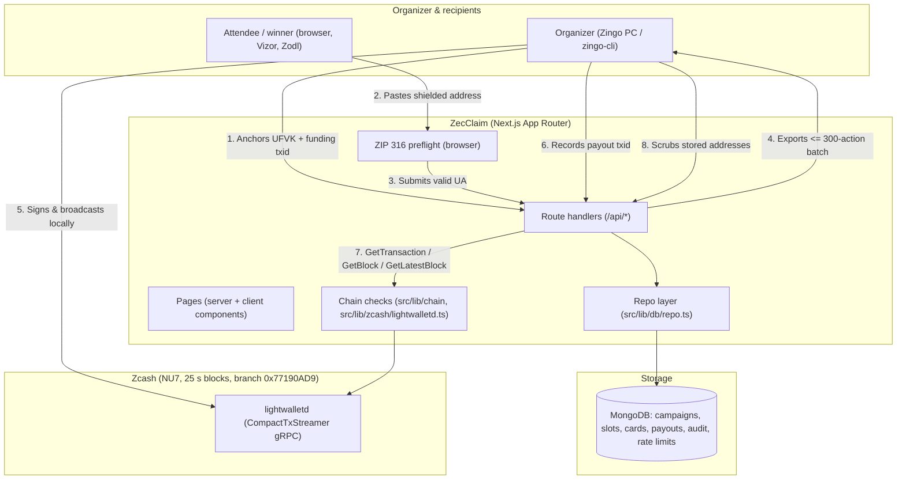
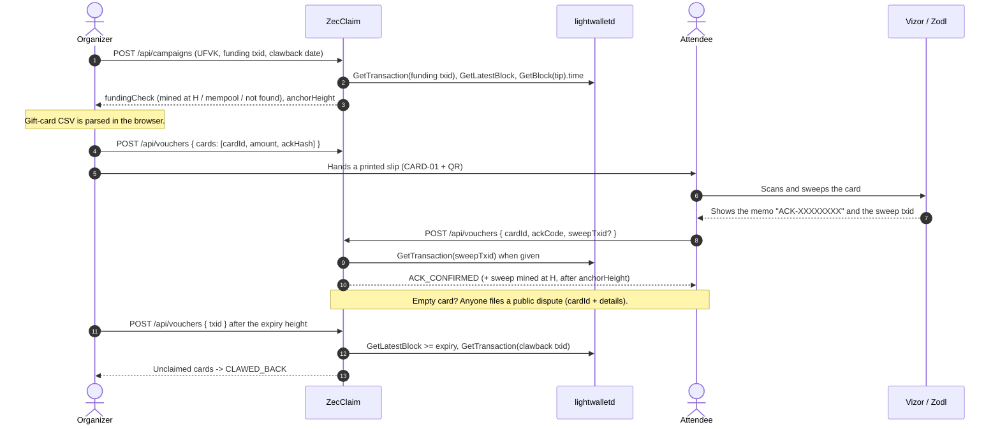
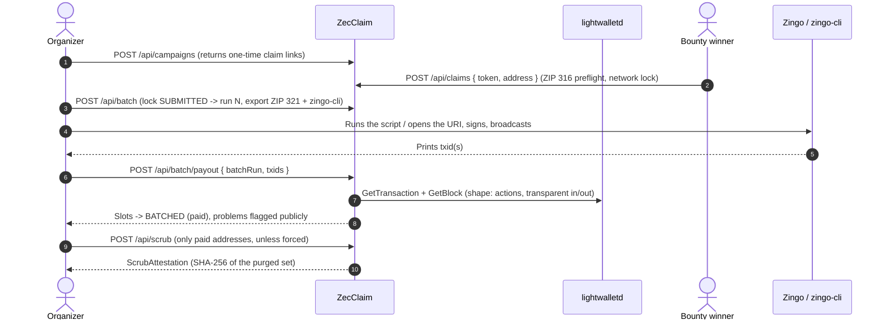

# ZecClaim System Architecture & Technical Specification

**Deployment Environment:** Vercel (Next.js App Router, Node.js runtime) + MongoDB Atlas (free tier)
**Chain access:** public lightwalletd gRPC (`testnet.zec.rocks:443`, `zebra.openlightnodes.org:443`)
**Security Boundary:** Non-custodial. No spending key, seed or signed transaction ever reaches the server.

---

## 1. High-Level Architecture Overview

ZecClaim is a coordination and audit layer. It validates addresses, builds payout batches for the organizer's own wallet, looks transactions up on-chain, and publishes a ledger. It never signs or broadcasts.

---

## 2. Lane Workflows

### 2.1 Lane 1: Offline meetups (ZIP 324 gift cards)

ZecClaim cannot observe a gift card being swept: each card is its own spending key, which the campaign UFVK does not cover. States therefore record what recipients reported and what the chain confirmed (section 7).

### 2.2 Lane 2: Online bounties (claim links + shielded batch)

---

## 3. Data Model (`src/lib/db/models/index.ts`, types in `src/types/index.ts`)

All reads and writes go through `src/lib/db/repo.ts`, which has a MongoDB and an in-memory implementation of the same interface. Conditional updates (`onlyIfStatus`, `onlyIfState`) are atomic in MongoDB.

| Collection | Key fields | Notes |
| :--- | :--- | :--- |
| `campaigns` | `campaignId`, `network`, `lane`, `ufvk`, `fundingTxid`, `fundingCheck`, `anchorHeight`, `totalFundedZat`, `cardPlanZat`, `clawbackAddress`, `clawbackExpiryHeight`, `clawbackAt`, `adminSecretHash`, `publishUfvk`, `isDemo` | `fundingCheck` is the stored `ChainTxCheck`; re-checked lazily by the proof portal while it can still change. `clawbackAt` is the date the organizer picked; `clawbackExpiryHeight` was derived from it. `cardPlanZat` (optional, Lane 1 / Hybrid): the gift-card amounts anchored before minting, one entry per card; absent when amounts come from the CSV. Index `(network, fundingTxid)`: one funding txid per campaign. |
| `claimslots` | `tokenHash` (unique), `campaignId`, `slotIndex`, `amountZat` (per link: split, fixed or custom), `status`, `recipientAddress`, `addressPoolType`, `batchRun`, `batchIndex`, `payoutTxid`, `payoutReport`, `payoutReportedAt`, `purgeHash` | Status: `UNCLAIMED -> SUBMITTED -> LOCKED_FOR_BATCH -> BATCHED -> PURGED`. `payoutTxid` survives the scrub. `payoutReport` (`NOT_RECEIVED` / `WRONG_AMOUNT`) is the link holder's public report on a recorded payout; set once, never cleared. No TTL index. |
| `vouchercards` | `campaignId + cardId` (unique), `amountZat`, `feeBufferZat`, `ackCodeHash`, `state`, `sweepTxid`, `sweepCheck`, `ackSubmittedAt`, `disputeReason`, `disputedAt`, `clawbackTxid` | State: `UNCLAIMED`, `ACK_CONFIRMED`, `DISPUTED`, `CLAWED_BACK`. A confirmed card can carry a later dispute. |
| `payouts` | `campaignId`, `batchRun`, `chunkIndex`, `recipients`, `txid`, `check`, `recordedAt` | Unique on `(campaignId, batchRun, chunkIndex)` and `(campaignId, txid)`; index on `txid` for the cross-campaign check (one transaction pays one campaign, enforced by the route). |
| `auditevents` | `campaignId`, `eventType`, `details`, `txid`, `blockHeight`, `timestamp` | Types: `CAMPAIGN_ANCHORED`, `FUNDING_CHECKED`, `SLOT_CLAIMED`, `ACK_VERIFIED`, `DISPUTE_FLAGGED`, `BATCH_LOCKED`, `PAYOUT_RECORDED`, `PII_SCRUBBED`, `CLAWBACK_RECONCILED`, `LINKS_REISSUED`. Demo fixtures carry `details.simulated: true`. |
| `scrubattestations` | `campaignId`, `addressesPurgedCount`, `sha256PurgedSetHash`, `executedAt` | |
| `ratelimitbuckets` | `key` (unique), `count`, `expiresAt` (TTL) | Fixed-window counters shared by all instances. |

`ChainTxCheck` = `{ status: MINED | MEMPOOL | NOT_FOUND | UNREACHABLE | SKIPPED, txid, network, height, tipHeight, confirmations, shape, checkedAt, endpoint, note }`, where `shape` counts transparent inputs/outputs, Sapling spends/outputs, Orchard actions and Ironwood actions.

---

## 4. Data Retention

- Recipient addresses live in `claimslots` from submission until the scrub. The scrub only purges paid recipients (a recorded payout txid) unless the organizer forces it.
- The proof portal shows how many addresses are still stored, so an organizer who never scrubs is visible.
- There is no TTL on ledger records: deleting slots would silently change the public ledger. Any TTL index left on `claimslots` by early builds is dropped automatically on the first database connection (`src/lib/db/mongodb.ts`), which also builds the declared indexes.

---

## 5. API Endpoint Contracts

**Public projections:** `src/lib/security/publicViews.ts` (and `getCampaignProofData`) define what may leave the server. Hashes, token hashes, recipient addresses and the full UFVK (unless `publishUfvk`) never do; the UFVK is replaced by its SHA-256 fingerprint.

**Errors:** route catch blocks use `errorResponse` (`src/lib/http.ts`): 400 for bad input, 503 when the database is configured but unreachable in production.

| Route | Method | Auth | Description |
| :--- | :--- | :--- | :--- |
| `/api/campaigns` | `POST` | Public, 10/h per IP | Anchor a campaign. UFVK fully validated (ZIP 316), seed phrases / spending keys refused, fee-aware slot amounts: split evenly (default), `slotAmountZat` on every link, or `slotAmountsZat` (one per link, length = `slotCount`). Optional `cardPlanZat` (Lane 1 / Hybrid, up to 1,000 cards) anchors the gift-card amounts; links, batch fee and plan (+ 2,000 zat sweep buffer per card) must fit the funding (400 otherwise). Response tokens carry each link's `amountZat`; `slotAmountZat` is null when the amounts differ. The funding txid must be on-chain (not found = 422, node unreachable = 503) with at least one shielded output once mined, and not used by another campaign (409). Clawback as `clawbackAt` (ISO date, converted to a height from the live tip block's timestamp; 1 hour to 1 year ahead) or `clawbackExpiryHeight` (must be above the tip). Stores `fundingCheck`, `anchorHeight`, `clawbackAt`. Returns the organizer secret and claim links once. |
| `/api/campaigns` | `GET` | Public | `?campaignId=` only (400 without it): public projection. There is no campaign listing. |
| `/api/campaigns/[id]` | `GET` | Public | Campaign, slot and card summaries, recorded payouts, recent events (sanitized), `isDemo`. Polled by the console every 15 s. |
| `/api/campaigns/[id]/verify` | `POST` | Admin | 200 if `x-admin-secret` is right (the console's sign-in), 401/403 otherwise; wrong secrets are limited to 20 per 10 min per IP (429). |
| `/api/campaigns/[id]/links` | `POST` | Admin | Reissue claim links for `UNCLAIMED` slots (all, or `slotIndexes`). Atomic per slot (never touches a slot that received an address); old links stop working; new links returned once; `LINKS_REISSUED` event. |
| `/api/campaigns/[id]/addresses` | `POST` | Admin | Stored recipient address per claim link (`slotIndex`, `address`, `poolType`) for the organizer console; `no-store`. Scrubbed addresses are not listed. Exposes nothing beyond what every batch export already gives the organizer; the public `GET /api/campaigns/[id]` keeps withholding addresses. A record of what was submitted, not proof of payment: only the campaign viewing key shows who a payout paid (SECURITY_AND_TRUST, Threat 7). |
| `/api/campaigns/[id]/import-luma` | `POST` | Admin | Import pre-collected addresses (PII columns dropped in the browser). Per-row ZIP 316 preflight; Lane 1-only campaigns refused; over-allocation refused (409), counting open card-plan entries as reserved. |
| `/api/claims/validate` | `POST` | Public, rate limited | Resolve a claim token to amount and progress: status, masked address (until the scrub), batch run, payout txid with its chain status/height/confirmations, and the holder's payout report if any. The claim page polls it every 30 s. |
| `/api/claims/report` | `POST` | Claim token, 10/min per IP | The link holder reports the recorded payout as `NOT_RECEIVED` or `WRONG_AMOUNT` (fixed values: no free text, so no address can reach the portal). Only once a payout is recorded (409 before), once per link (atomic, 409 after). Public on the proof portal by link number; the slot moves from distributed to awaiting in the ledger; `DISPUTE_FLAGGED` event with `kind: "PAYOUT_REPORT"`. |
| `/api/claims` | `POST` | Public, rate limited | ZIP 316 preflight with network lock, then conditional `UNCLAIMED -> SUBMITTED`. |
| `/api/batch` | `POST` | Admin | Lock `SUBMITTED` slots into a new run and export ZIP 321 URIs + a zingo-cli script. With nothing new, re-exports the latest unpaid run. Runs with a recorded payout are never re-exported. |
| `/api/batch/payout` | `POST` | Admin | Record the txid(s) of an exported run, one per chunk. A txid already recorded by another campaign as a payout or as its funding is refused (409; sandbox records never block a real campaign). Each is looked up: not found = 422, mined before the campaign's `anchorHeight` = 422 (sandbox exempt: its anchor is a fixture), node unreachable = 503 (except demo); otherwise stored with its shape, problems (too few shielded outputs, transparent inputs/outputs) flagged publicly, and the run's slots move to `BATCHED` with `payoutTxid`. |
| `/api/scrub` | `POST` | Admin | Overwrite stored addresses, emit `ScrubAttestation`. Refuses (409 `UNPAID_RECIPIENTS`) while any stored address has no recorded payout, unless `force: true`. |
| `/api/vouchers` | `POST` | Mixed | By body: `ackCode` (public; card `UNCLAIMED` or `DISPUTED`; optional `sweepTxid` must be on-chain, mined after `anchorHeight`, and unique per card), `details` (public dispute, one per card, also on confirmed cards), `txid` (admin clawback: chain tip must be past the expiry height and the txid on-chain; demo is labeled simulated instead), else `cards` (admin import: duplicates 409, lane check, card plan check: with a `cardPlanZat`, every card must match an open plan amount or the whole import is refused with 409 and `remainingPlanZat`; budget check). |
| `/api/chain/tx` | `GET` | Public, 30/min per IP | `?network=&txid=`: a `ChainTxCheck`. Used by the campaign form. |
| `/api/chain/tip` | `GET` | Public, 60/min per IP | `?network=`: current height and the tip block's timestamp `timeMs` (or nulls with a note). Used by the form's date preview, the console and the live sidebar status. |
| `/api/proof`, `/api/proof/[id]` | `GET` | Public | Proof data: anchor (UFVK fingerprint), ledger, `cardPlan` (`amountsZat`, `totalZat`, `registeredCount`, `openZat`, or null), chain checks (funding, payouts, sweeps), cards, slots, events, scrub attestation, `addressesStored`. Stale checks are refreshed at most once a minute (never for demo fixtures). |
| `/api/demo/reset` | `POST` | Public, 10/min per IP | Re-seed the sandbox campaign only (404 when `NEXT_PUBLIC_ZECCLAIM_SANDBOX=off`). |

**Budget & ledger:** `src/lib/campaign/budget.ts` places every zatoshi of declared funding in one bucket: distributed (confirmed cards, slots with `payoutTxid` and no `payoutReport`), awaiting (addresses not paid yet, payouts reported missing, disputed cards), unclaimed, clawed back, fees and buffers, unallocated. Open card-plan entries are reserved by the budget checks but stay in "unallocated" on the public ledger until a matching card is registered. `src/lib/campaign/amountPlan.ts` resolves the form's amount modes (split, fixed, custom) for links and cards with the same rules as the server (PROTOCOL_SPECS 5.1).

**Judge sandbox:** `src/lib/demo/fixtures.ts` is the single source for the sandbox (memory store and MongoDB seed). It is seeded only when `/sandbox` (or one of its pages) is opened, never on the home page, and disappears entirely with `NEXT_PUBLIC_ZECCLAIM_SANDBOX=off`. Its txids are fixtures, stored as `SKIPPED` with a "Demo fixture" note; txids a judge records in the sandbox are checked against the real node. Real campaigns never use fixtures: the creation form has no generated values.

**Security headers (`next.config.ts`):** CSP (same origin), `Referrer-Policy: no-referrer` (claim tokens are in URL paths), `X-Frame-Options: DENY`, `nosniff`, HSTS, and `X-Robots-Tag: noindex` + `Cache-Control: no-store` on `/claim`, `/admin` and `/api`.

---

## 6. Client vs. Server Responsibility Matrix

| Responsibility | Browser | Server | Organizer's wallet |
| :--- | :---: | :---: | :---: |
| Private keys / seeds | Never | Never | Exclusively |
| ZIP 316 preflight (feedback) | Yes | | |
| ZIP 316 preflight (enforcement) | | Yes | |
| Gift-card `#key=` links (QR slips) | Yes, in memory only | Never | Creates them |
| Claim tokens and admin secrets | Organizer secret in `sessionStorage` (or `localStorage` if "remember") | CSPRNG + peppered hash | |
| "My campaigns" list | `localStorage` only | No public listing | |
| Clawback date to block height | Preview | Authoritative (live tip) | |
| Batch chunking (<= 300 actions) | | Yes | |
| Signing and broadcasting | Never | Never | Exclusively |
| On-chain lookups (txid, tip, shape) | | Yes (lightwalletd) | |
| Address scrub + commitment | | Yes | |

---

## 7. On-Chain Checks and Their Limits

`src/lib/zcash/lightwalletd.ts` is a minimal client for the `cash.z.wallet.sdk.rpc.CompactTxStreamer` gRPC service (hand-written protobuf codec, `@grpc/grpc-js` transport). `src/lib/chain/txCheck.ts` uses it:

1. `GetLightdInfo` once per 10 minutes per endpoint: refuses a node that serves the wrong chain.
2. `GetTransaction(txid)` (txid bytes in protocol order, i.e. the display hex reversed): height 0 = mempool, `u64::MAX` = fork only, error NOT_FOUND = unknown.
3. `GetBlock(height)` for mined txs: the matching `CompactTx` gives the shape (fields 4-9: Sapling spends/outputs, Orchard actions, transparent vin/vout, Ironwood actions).
4. `GetLatestBlock` for confirmations, the anchor height and clawback expiry.

What this proves: a txid exists on the campaign's network, when it was mined, whether it touches the transparent pool, and how many shielded outputs it can hold. What it cannot prove: shielded amounts, recipients or memos. Today an auditor holding the viewing key checks those in their own wallet: the proof portal's viewing-key guide (`src/components/proof/ViewingKeyAuditCard.tsx`, commands from `viewingKeyAuditCommands` in `src/lib/zcash/zingoScript.ts`) gives the fingerprint check, a view-only zingo-cli wallet command pre-filled with the network, server and a birthday just before the funding height, and the expected transfers per payout txid from ZecClaim's records. It has no key input. Having ZecClaim verify them itself needs trial decryption with the viewing key (a WASM build of the Zcash crates), which is the next step:

- **Funding amount:** decrypt the funding tx outputs with the campaign UFVK's incoming viewing key.
- **Payout recipients:** decrypt the payout outputs with the OVK and compare the commitment of each (address, amount) against the exported batch, then publish only the match result.
- **Gift-card sweeps:** derive each card's FVK in the browser from its `#key=` link at import, send only its nullifier-deriving key and the funding note position, and scan compact blocks for the card's nullifier.
