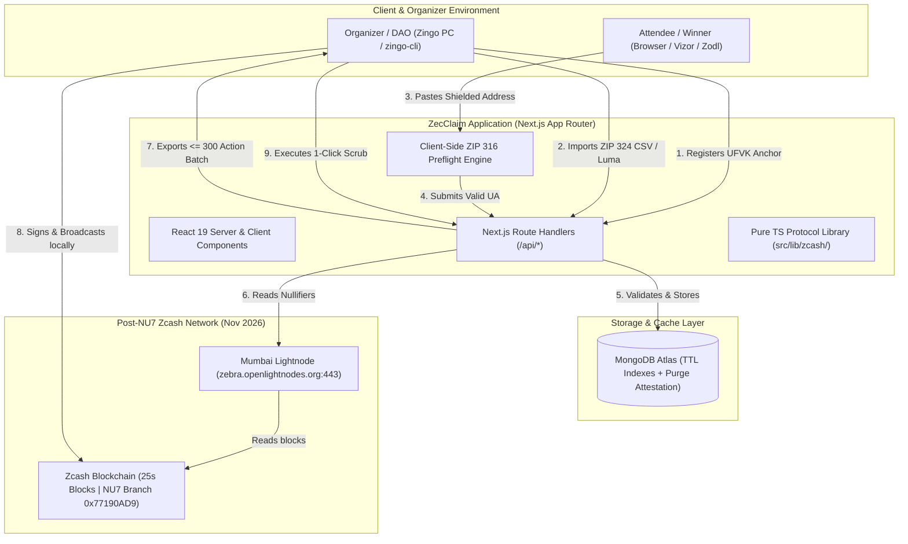
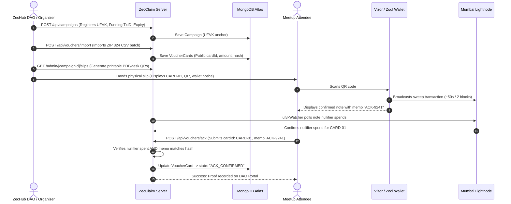
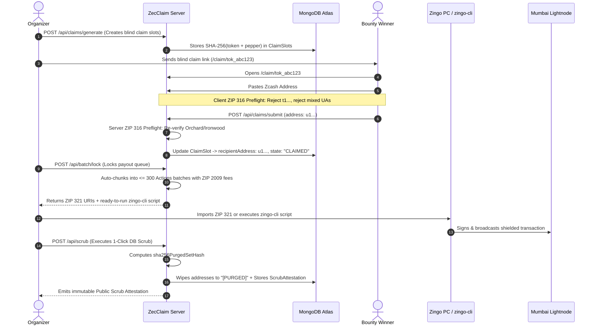

# ZecClaim System Architecture & Technical Specification

**Version:** 1.0.0 (Phase 0 Scaffold)  
**Deployment Environment:** Vercel (Next.js App Router) + MongoDB Atlas (Free Tier)  
**Security Boundary:** 100% Non-Custodial  

---

## 1. High-Level Architecture Overview

ZecClaim is designed as a stateless, non-custodial coordination layer. Private spending keys never touch the network; the application acts exclusively as a preflight validator, batch aggregator, and cryptographic audit witness.



---

## 2. Lane Workflows (Mermaid Sequence Diagrams)

### 2.1 Lane 1: Offline Meetups & Zero-Wallet Onboarding (ZIP 324 Bearer QRs)



### 2.2 Lane 2: Online Bounties & Async Payouts (Direct Shielded Batch)



---

## 3. Database Architecture & Mongoose Schemas

All models reside in `src/lib/db/models/` and are built for MongoDB Atlas free tier with auto-indexing.

### 3.1 `Campaign` Schema
Stores the campaign anchor, registered viewing key, and parameters.
```typescript
interface ICampaign {
  campaignId: string;             // SHA-256(ufvk + fundingTxid).slice(0, 16)
  title: string;                  // e.g., "ZecHub India Hackathon Nov 2026"
  description?: string;
  lane: "OFFLINE_ZIP324" | "ONLINE_BATCH" | "HYBRID";
  ufvk: string;                   // Unified Full Viewing Key ("uview...")
  fundingTxid: string;            // 64-character hex transaction ID
  totalFundedZat: number;         // Total funded amount in satoshis
  slotCount: number;              // Total number of claim slots or vouchers
  clawbackAddress: string;        // DAO treasury address for returning unspent funds
  clawbackExpiryHeight: number;   // Block height after which unspent funds are clawed back
  status: "ACTIVE" | "LOCKED" | "COMPLETED" | "CLAWED_BACK";
  createdAt: Date;
  updatedAt: Date;
}
```

### 3.2 `ClaimSlot` Schema (Lane 2)
Stores blind claim tokens and submitted shielded addresses prior to scrubbing.
```typescript
interface IClaimSlot {
  campaignId: string;
  tokenHash: string;              // SHA-256(token + pepper) - token itself never saved
  amountZat: number;              // Disbursement amount per slot
  slotIndex: number;              // Order index (0..N-1)
  status: "UNCLAIMED" | "SUBMITTED" | "BATCHED" | "PURGED";
  recipientAddress?: string;      // Shielded UA string (replaced with "[PURGED]" on scrub)
  addressPoolType?: "ORCHARD" | "IRONWOOD" | "SAPLING";
  submittedAt?: Date;
  batchIndex?: number;            // Which <=300 action batch this slot was assigned to
  purgeHash?: string;             // Included in scrub attestation
  createdAt: Date;
}
```

### 3.3 `VoucherCard` Schema (Lane 1)
Stores public card metadata for ZIP 324 gift cards. **No secret seeds or private keys are stored.**
```typescript
interface IVoucherCard {
  campaignId: string;
  cardId: string;                 // e.g., "CARD-01", "CARD-02"
  amountZat: number;              // Face value of card in zatoshi
  feeBufferZat: number;           // Explicit sweep fee buffer (minimum 2,000 zat)
  nullifierHex?: string;          // Extracted note nullifier for watch-only tracking
  ackCodeHash: string;            // SHA-256(ACK-XXXX) stored inside encrypted memo
  state: "UNCLAIMED" | "SPENT" | "ACK_CONFIRMED" | "DISPUTED" | "CLAWED_BACK";
  spentAtHeight?: number;         // Detected spend height from UFVK
  spentTxid?: string;
  ackSubmittedAt?: Date;
  disputeReason?: string;
  createdAt: Date;
}
```

### 3.4 `AuditEvent` Schema
Records append-only public accounting events verified via UFVK.
```typescript
interface IAuditEvent {
  campaignId: string;
  eventType: 
    | "CAMPAIGN_ANCHORED" 
    | "SLOT_CLAIMED" 
    | "NULLIFIER_SPENT" 
    | "ACK_VERIFIED" 
    | "DISPUTE_FLAGGED" 
    | "BATCH_LOCKED" 
    | "PII_SCRUBBED" 
    | "CLAWBACK_RECONCILED";
  details: Record<string, unknown>;
  blockHeight?: number;
  txid?: string;
  timestamp: Date;
}
```

### 3.5 `ScrubAttestation` Schema
Permanent proof of address destruction.
```typescript
interface IScrubAttestation {
  campaignId: string;
  addressesPurgedCount: number;
  sha256PurgedSetHash: string;    // SHA-256 hash of sorted, concatenated purged addresses
  executedAt: Date;
  receiptTxid?: string;           // Optional payout transaction ID associated with batch
}
```

---

## 4. TTL Index & Data Retention Strategy

To strictly minimize liability and data retention:
1. **Automatic Expiry:** `ClaimSlot` collection contains a compound TTL index:
   ```typescript
   ClaimSlotSchema.index({ createdAt: 1 }, { expireAfterSeconds: 604800 }); // 7 days
   ```
2. **Explicit Scrub Override:** When the organizer triggers the 1-Click Scrub API, the raw `recipientAddress` field is immediately rewritten to `"[PURGED]"` and the hash is committed to `ScrubAttestation`. The TTL index acts as an automated fallback if the organizer fails to trigger the scrub manually.

---

## 5. API Endpoint Contracts

| Route | Method | Description | Request Body / Params |
| :--- | :--- | :--- | :--- |
| `/api/campaigns` | `POST` | Anchor new campaign with UFVK | `CreateCampaignSchema` |
| `/api/campaigns/[id]` | `GET` | Get campaign details & status | `campaignId` |
| `/api/claims/validate` | `POST` | Validate blind claim token | `{ token: string }` |
| `/api/claims/submit` | `POST` | Server ZIP 316 preflight & lock slot | `{ token: string, address: string }` |
| `/api/batch/lock` | `POST` | Lock queue & chunk into <=300 actions | `{ campaignId: string }` |
| `/api/batch/export` | `GET` | Download ZIP 321 URIs or zingo script | `?campaignId=xxx&format=zip321\|zingo` |
| `/api/vouchers/import` | `POST` | Ingest Vizor CSV manifest | `{ campaignId: string, cards: [...] }` |
| `/api/vouchers/ack` | `POST` | Submit memo ACK code for spent card | `{ campaignId: string, cardId: string, ackCode: string }` |
| `/api/vouchers/dispute` | `POST` | Flag already-redeemed gift card | `{ campaignId: string, cardId: string, details: string }` |
| `/api/proof/[id]` | `GET` | Public audit ledger & stats | `campaignId` |
| `/api/scrub` | `POST` | 1-Click PII wipe & attestation | `{ campaignId: string }` |

---

## 6. Client vs. Server Responsibility Matrix

| Feature / Responsibility | Client / Browser | Server / Next.js API | Local Wallet (Zingo / zingo-cli) |
| :--- | :---: | :---: | :---: |
| Private Key / Seed Management | ❌ Never | ❌ Never | ✅ Exclusively |
| ZIP 316 Preflight (Immediate Feedback) | ✅ Full Bech32m + F4Jumble | ❌ (Client First) | ❌ |
| ZIP 316 Preflight (Enforcement Gate) | ❌ | ✅ Full Bech32m + F4Jumble | ❌ |
| Token CSPRNG Generation | ❌ | ✅ Secure Salt/Hash | ❌ |
| Payout Transaction Broadcast | ❌ Never | ❌ Never | ✅ Exclusively |
| Batch Auto-Chunking (<=300 actions) | ❌ | ✅ ZIP 2009 Calculator | ❌ |
| Watch-Only UFVK Sync | ❌ | ✅ Lightnode Query | ❌ |
| 1-Click PII Purge & Attestation | ❌ | ✅ Cryptographic Hash | ❌ |
